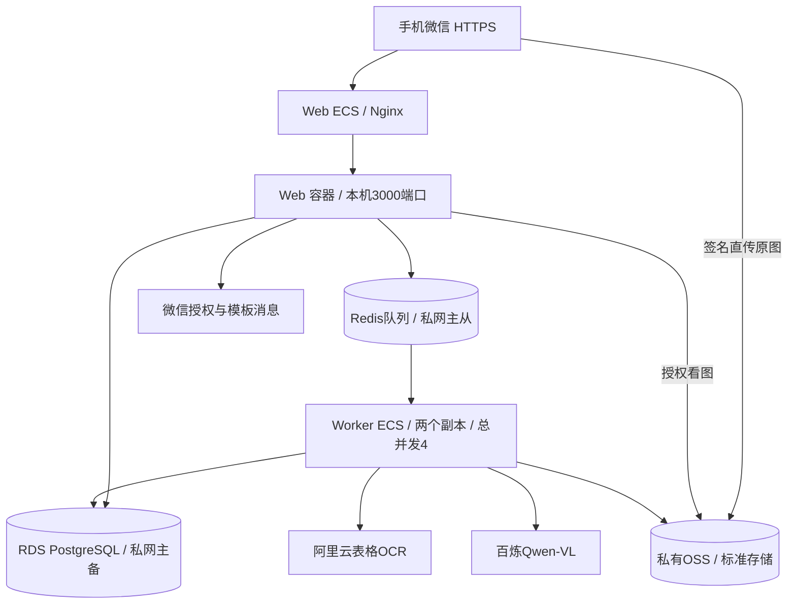

# 食安链阿里云生产部署手册

2026年10月23日 版本1.0

2026-10-28 业务规则补充：用户已确认同供应商同单号跨日期也只提醒，允许提交和普通审核，源码已更新并通过回归。本文原编制日期的“沿现状、不扩大查重”不再用于限定当前查重日期范围；以[最新规则确认](../acceptance-2026-10-28/重复单号规则确认与回归.md)和[上线前待办清单](../上线前待办清单-2026-10-28.md)为准。正式部署应使用最新源码制品，旧交付包继续仅作配置与采购参考。

本方案面向送货单识别和多项目比价系统的技术实施及运维人员。推荐将Web与OCR Worker分开部署，采用RDS PostgreSQL高可用实例、标准主从Redis兼容实例和私有OSS。手机微信直接访问阿里云HTTPS地址，不依赖本地电脑或中转隧道。

用户已确认采用正式生产和托管数据库及Redis，并确认以30个项目点、200个账号、每天500张单、每单3页及峰值10人同时操作作为采购测算基准，同时提供300、500、1000单的预算对比。这些数量是测算基准，不代表已经验证的容量上限。计费规格以目标地域实际可售资源和采购确认单为准。

## 一 部署结论与技术基线

| 项目 | 当前实现和部署选择 |
| --- | --- |
| 应用 | Next.js 16.4.2 React 19.3.1 TypeScript Node.js 24 |
| 数据访问 | Prisma 7.10.1 PostgreSQL 17 对应现有迁移 |
| 异步任务 | BullMQ 6.3.17 Redis 7兼容 每个Worker进程并发2 |
| 识别 | 阿里云RecognizeTableOcr逐页调用 Qwen-VL每单一个多图请求 |
| 文件 | 私有OSS 浏览器签名直传 原图在线保留5年 |
| 身份与通知 | 员工号登录 微信网页授权和模板通知 |
| 首期形态 | 1台Web ECS 1台Worker ECS RDS主备 Redis主从 |
| 发布 | Linux Docker镜像 Web与Worker使用同一制品版本 |

已确认的低置信度提示与提交流程、跨日期跨项目查重范围均沿现状验收。本部署不新增强制确认或扩大查重，不将两项列为缺陷或部署阻断。其他修复按最新验收清单回归。

首期方案的数据层采用主备保障，但Web仍为单节点。应用机故障需要恢复镜像或切换实例；不能据此宣称整个系统双活或无中断。若要求单机故障时业务不中断，按采购文档增配双Web及负载均衡，并先处理多实例限流。

## 二 架构与组件调用



手机通过HTTPS进入Web ECS上的Nginx，转发至仅监听本机3000端口的应用。Web通过私网访问RDS和Redis；Redis保存OCR任务。Worker通过相同私网访问RDS和队列，获取OSS原图并调用OCR和Qwen-VL，再写回明细、匹配结果和异常。

OSS模式下当前代码只持久化原图，预处理在内存完成；增强图只在本地存储模式落盘。因此云部署不能承诺已经保存增强图。手机看图仍走受权限控制的应用接口，相关OSS回源和ECS出网费用在预算中预留。

应用和数据默认放在华东1杭州同一VPC。为资源选择两个可用区，RDS主备跨可用区；Worker可放另一可用区。选择两个私网交换机，并核对路由、DNS和区域库存。Web和Worker各绑定固定EIP，避免额外采购NAT；Worker公网入站全部拒绝，公网仅用于出站识别请求。

| 资源 | 首期规格 | 网络和部署边界 |
| --- | --- | --- |
| Web ECS | x86 4vCPU 8GB 80GB系统盘 | Ubuntu24.04 Nginx Web容器 固定EIP |
| Worker ECS | x86 4vCPU 8GB 80GB系统盘 | 两个Worker容器 总任务并发4 固定EIP |
| RDS | PostgreSQL17 高可用 2vCPU4GB 100GB盘 | 仅私网 一套含主备 规格须采购核验 |
| Redis兼容实例 | 标准非分片主从 可用内存2GB | 兼容Redis7 私网TLS noeviction 支持BullMQ |
| OSS | 私有标准存储 优先同城冗余 | 同地域 开版本控制 不设5年前自动删除 |
| 日志备份 | SLS RDS备份 ECS快照 | 与生产账号权限分离 明确保留和恢复责任人 |

不采购JDK、GPU、本地大模型、RabbitMQ或DeepSeek调用额度。现有业务代码不依赖这些资源。

## 三 采购前置条件和开通顺序

1. 企业持有阿里云账号、域名和公众号，完成实名、费用账户和管理员交接。供应商通过RAM临时授权实施，不持有唯一管理员账号。
2. 确定地域、VPC、两个交换机和安全组。确认PostgreSQL17及Redis7兼容主从规格可售；无法购买时先做兼容性验证，不自行替换数据库版本或Redis集群架构。
3. 创建RDS、Redis与私有OSS，核实TLS、备份保留、访问账号和资源额度。
4. 创建两台ECS及系统盘，绑定EIP，使用云助手或受限SSH管理。
5. 开通OCR与百炼，申请峰值额度。四个并行任务、每单最多五页，可能形成20个同时在途的OCR请求；这不是20 QPS，需按实际批次耗时、突发请求和服务限制实测、限速或申请额度。
6. 完成企业域名备案、DNS、HTTPS证书、公众号网页授权和接口IP白名单。
7. 购买或启用SLS、备份超额容量、监控通知与预算告警。先按量验证一周，再决定包年包月和资源包数量。

| 安全组 | 入站允许 | 其他要求 |
| --- | --- | --- |
| Web | 公网TCP80和443 管理来源TCP22或云助手 | 不开放3000 可信反代覆盖客户端转发头 |
| Worker | 仅管理来源TCP22或云助手 | 公网没有业务监听端口 |
| RDS | 两台ECS安全组或精确私网地址的5432 | 禁用公网地址 使用TLS实际端口 |
| Redis | 两台ECS安全组或精确私网地址的实例端口 | 不允许0.0.0.0/0 使用产品分配的TLS端口 |

不能把测试用PGlite带到生产，也不把本地演示数据库直接作为正式初始数据。

## 四 准备系统和发布制品

两台ECS选择Ubuntu Server24.04 LTS。Docker运行应用，不需要在宿主机安装Node或JDK。用专门的运维账号实施；以下需要管理员权限的命令在root维护会话或按本企业sudo规范执行。

```bash
sudo apt-get update
sudo apt-get install -y ca-certificates curl openssl
sudo install -m 0755 -d /etc/apt/keyrings
sudo curl -fsSL https://download.docker.com/linux/ubuntu/gpg \
  -o /etc/apt/keyrings/docker.asc
sudo chmod a+r /etc/apt/keyrings/docker.asc
echo "deb [arch=$(dpkg --print-architecture) signed-by=/etc/apt/keyrings/docker.asc] https://download.docker.com/linux/ubuntu noble stable" \
  | sudo tee /etc/apt/sources.list.d/docker.list
sudo apt-get update
sudo apt-get install -y docker-ce docker-ce-cli containerd.io \
  docker-buildx-plugin docker-compose-plugin
sudo systemctl enable --now docker
sudo install -m 755 -d /etc/delivery-audit/certs
sudo install -d /opt/delivery-audit/app /opt/delivery-audit/deploy
```

只在Web ECS安装Nginx与Certbot：

```bash
sudo apt-get install -y nginx certbot
```

当前工作区没有Git元数据。发布源码包必须附SHA256，排除node_modules、.next、.data、.env及任何真实密钥，同时排除临时目录和文档产物。Windows PowerShell示例：

```powershell
tar.exe --exclude=node_modules --exclude=.next --exclude=.data `
  --exclude=.npm-cache --exclude=.git --exclude=".env*" `
  --exclude=.tmp --exclude=output --exclude=outputs `
  --exclude="*.log" --exclude="*.tsbuildinfo" `
  -czf D:\delivery-audit-20261023-01.tar.gz -C D:\codex\gysycl .
Get-FileHash D:\delivery-audit-20261023-01.tar.gz -Algorithm SHA256
scp D:\delivery-audit-20261023-01.tar.gz <运维账号>@<Web地址>:/tmp/
```

在Web ECS解包至应用目录，核对哈希后构建一次：

```bash
tar -xzf /tmp/delivery-audit-20261023-01.tar.gz \
  -C /opt/delivery-audit/app
cd /opt/delivery-audit/app
docker build -t delivery-audit:20261023-01 .
docker image save delivery-audit:20261023-01 \
  | gzip > /tmp/delivery-audit-image-20261023-01.tar.gz
sha256sum /tmp/delivery-audit-image-20261023-01.tar.gz
```

通过私网或受控传输把同一镜像包交给Worker ECS，校验后执行docker image load。后续使用企业镜像仓库可省去传包步骤，ACR属于可选采购。不要把Windows依赖目录直接复制到Linux。

## 五 数据库和业务配置

项目原默认模型是qwen-vl-max-latest，当前官方价格页未列出该名称，不能据此断言账号已经不可用。本部署模板改为可配置候选qwen3-vl-plus，并使用北京业务空间的OpenAI兼容地址；该系列官方文档说明默认关闭思考。上线前必须验证账号模型可用性、多图输入、现有response_format JSON参数和30张真单效果。如原模型仍可用且希望沿用，保留原模型及对应接入地址并另行核价，不能把候选模型价格当成原模型价格。本次仅提供配置模板，不修改业务代码默认值。

创建delivery_audit数据库、迁移账号delivery_migrator和运行账号delivery_app。迁移账号拥有应用schema的建表及变更权限；运行账号仅具有业务读写权限，不使用实例高权限账号长期运行。迁移后用有权限的账号执行，并根据真实schema调整：

```sql
GRANT CONNECT ON DATABASE delivery_audit TO delivery_app;
GRANT USAGE ON SCHEMA public TO delivery_app;
GRANT SELECT, INSERT, UPDATE, DELETE ON ALL TABLES IN SCHEMA public TO delivery_app;
GRANT USAGE, SELECT ON ALL SEQUENCES IN SCHEMA public TO delivery_app;
ALTER DEFAULT PRIVILEGES FOR ROLE delivery_migrator IN SCHEMA public
  GRANT SELECT, INSERT, UPDATE, DELETE ON TABLES TO delivery_app;
ALTER DEFAULT PRIVILEGES FOR ROLE delivery_migrator IN SCHEMA public
  GRANT USAGE, SELECT ON SEQUENCES TO delivery_app;
```

两台ECS安装包中的compose.aliyun.yml至/opt/delivery-audit/deploy。它独立连接托管服务，不叠加项目原docker-compose.yml。原文件会强制连接容器内数据库和Redis，不能直接用于本方案。

从随附.env.aliyun.example复制到/etc/delivery-audit/app.env，权限600，只在服务器填写实际配置。certs目录只放RDS和Redis要求的有效CA公钥证书，目录权限755、文件644，使容器node用户可以读取；不要在该目录放私钥。按控制台要求合并所需CA到aliyun-ca-bundle.pem，并在两端核对同一内容。

| 变量 | 正式值和作用 |
| --- | --- |
| APP_IMAGE | 两台主机统一的镜像标签或摘要 |
| APP_URL | 与手机访问域名完全相同的https地址 不带结尾斜杠 |
| SESSION_SECRET | 独立随机值 openssl rand -hex 32生成 两台一致 |
| DEMO_MODE | false 不写演示账号 不会主动删除旧演示数据 |
| DATABASE_URL | delivery_app私网连接 使用verify-full和RDS实际CA |
| REDIS_URL | 私网rediss连接 标准非分片主从 产品实际TLS端口 |
| NODE_EXTRA_CA_CERTS | 两台主机均可读的阿里云CA合并文件 用于需要自有CA的TLS连接 |
| OCR_MODE | aliyun 配齐OCR AccessKey和百炼API Key |
| STORAGE_DRIVER | oss 不使用容器文件作为正式图片存储 |
| OSS_REGION和OSS_BUCKET | 同地域私有Bucket |
| OSS_ENDPOINT | 浏览器可访问的外网HTTPS地址 当前版本不能改为仅ECS可达的internal地址 |
| WECHAT配置 | AppID Secret 两个模板ID Web EIP加入所需接口白名单 |

数据库、Redis用户名和密码放入URL时必须正确编码，推荐随机十六进制密码。TLS端口、证书链和域名验证必须按实例控制台实际资料配置，禁止以关闭证书校验解决连接问题。

OSS为浏览器直传配置精确CORS来源https://业务域名，允许PUT、GET、HEAD及Content-Type，按预检实际请求补充必要头。应用存储RAM账号只访问本Bucket的documents前缀，授予实际所需GetObject、PutObject，按业务清理需要授予DeleteObject；不授予删除历史版本权限。开版本控制，五年内不自动清除正式原图版本。版本控制不是完整异地备份，跨地域容灾另行采购。

目前OSS客户端读取明确的AccessKey变量，不能仅绑定ECS角色后就删除这些变量。首期使用受限RAM凭据，配置由负责人保管；后续改实例角色时要先做代码适配和回归。

## 六 执行迁移和启动服务

两端运维会话定义统一命令，后续不遗漏环境文件：

```bash
dc() {
  docker compose --env-file /etc/delivery-audit/app.env \
    -p delivery-aliyun -f /opt/delivery-audit/deploy/compose.aliyun.yml "$@"
}
dc config --quiet
```

Web端先使用迁移账号连接串执行迁移，交互输入避免把密码写进历史。一次只由一个发布进程执行迁移，不由每个Web启动时同时执行：

```bash
read -rsp "迁移账号完整连接串: " DATABASE_URL
printf '\n'
export DATABASE_URL
dc --profile web run --rm --no-deps -e DATABASE_URL \
  app npx prisma migrate deploy
unset DATABASE_URL
# 在RDS中执行上一节运行账号授权 然后启动Web
dc --profile web up -d app
dc --profile web ps
curl -fsS http://127.0.0.1:3000/api/health
```

Worker主机导入镜像和相同版本配置后：

```bash
gzip -dc /tmp/delivery-audit-image-20261023-01.tar.gz | docker image load
dc --profile worker up -d --scale worker=2 worker
dc --profile worker ps
dc --profile worker logs --tail=100 worker
```

Worker总并发为2乘2等于4，Redis接管任务分发。应用健康接口仅检查数据库，不包含队列、识别、OSS或微信。不得用健康接口成功替代完整联调。

## 七 HTTPS 微信和业务初始化

将域名A记录指向Web EIP，Web安全组放行80和443。Nginx在本机反代127.0.0.1:3000，传递Host并覆盖X-Forwarded-For，避免客户端伪造限流来源。随附nginx.aliyun.conf包含两个端口站点、微信校验文件和不记录查询参数的日志格式。

首次签发证书时先只启用模板中的80端口站点，创建/var/www/letsencrypt及/var/www/wechat。检查配置后执行：

```bash
sudo nginx -t
sudo systemctl enable --now nginx
sudo systemctl reload nginx
sudo certbot certonly --webroot -w /var/www/letsencrypt \
  -d <真实业务域名> --email <运维邮箱> --agree-tos
```

取得证书后启用完整443站点并再次nginx -t和重载。购买证书则改模板中的证书路径。使用Certbot时配置自动续期及部署钩子重载Nginx，执行certbot renew --dry-run；付费证书按到期提醒轮换。生产会话Cookie为Secure，手机必须使用正确域名的HTTPS。

在Web端创建唯一管理员，使用交互式输入：

```bash
read -rp "管理员员工号: " ADMIN_EMPLOYEE_NO
read -rsp "管理员密码: " ADMIN_PASSWORD
printf '\n'
export ADMIN_EMPLOYEE_NO ADMIN_PASSWORD
export ADMIN_NAME='系统管理员'
dc --profile web exec -e ADMIN_EMPLOYEE_NO -e ADMIN_PASSWORD \
  -e ADMIN_NAME app npm run create-admin
unset ADMIN_EMPLOYEE_NO ADMIN_PASSWORD ADMIN_NAME
```

管理员依次创建项目点、采购主管财务账号及项目成员关系，再导入供应商、原材料、项目合同价。正式库不运行seed、db:reset或迁移重置。

公众号后台填写网页授权域名，将要求的MP_verify文件放入/var/www/wechat，菜单指向https://业务域名/api/auth/wechat/start。按接口要求把Web EIP加入白名单。用户完成关注、授权和员工号绑定。

两个消息模板必须与代码使用的thing1、thing2、time3、amount4、phrase5相匹配。公众号账号是否具有所需消息权限和模板配额需实号验证，不以填写ID视为接入成功。当前失败通知会记入数据库，不应假定存在可靠的自动补发链路；须监控失败记录并落实人工处理。

## 八 启动验收和容量验证

```bash
dc --profile web ps
dc --profile web logs --tail=100 app
curl -fsS https://<真实业务域名>/api/health
# Worker主机另查Worker日志和重启次数
dc --profile worker logs --tail=100 worker
docker stats --no-stream
```

| 验证项 | 放行条件 |
| --- | --- |
| 配置 | 两台制品一致 无默认密钥 无演示数据 DB与Redis仅私网 |
| 文件 | 私有OSS直传和授权看图成功 越权403 过期签名拒绝 |
| OCR | 至少30张脱敏真实单 各约定关键字段准确率达到95% 两个通道分别有成功证据 |
| 业务 | 上传校正提交审核退回撤回重审导出闭环 财务只读 项目隔离 |
| 微信 | 手机关闭WiFi后授权绑定登录成功 两类消息送达并可打开 |
| 任务恢复 | 停一个Worker不丢任务 恢复后继续 无重复业务写入 |
| 故障恢复 | RDS主备切换 Redis切换 ECS重启恢复 备份恢复均有记录 |
| 初始负载 | 10人并发混合操作30分钟 普通读取接口P95目标2秒 OCR另统计排队和处理时间 |

性能阈值是上线验收建议，未实测前不能对外承诺。两个副本并发4、任务60秒的假设下理论处理能力240单每小时；这只是容量估算，需对1页和5页、云端限流及超时分别测试。队列最老任务等待超过10分钟、内存超过80%、错误率升高或磁盘超过70%时触发扩容评估。

## 九 备份 回滚和日常运维

RDS启用可实现的备份保留和日志备份，目标每日备份保留30天；若实例原生保留期不足，补选对应备份服务或导出能力。目标RPO不超过15分钟、Web恢复目标RTO不超过60分钟，须通过恢复演练确认，不作为已实现SLA。

上线前、每次有迁移的发布前额外做手工备份。每月将数据库逻辑快照加密归档至独立备份Bucket，月度归档按5年要求保留。原图保持私有标准存储及版本控制；转为归档会影响直接看图，首期不启用此转换。

普通应用日志保留7天、错误日志30天；数据库内操作日志按业务保留期管理。采集时屏蔽密码、AccessKey、Token、签名URL参数和原图内容。预算告警设50%、80%、100%，按负责人升级处理，不能仅报警无人接收。

发布前保存旧APP_IMAGE、环境文件加密备份和迁移版本。仅代码且数据库兼容的回退顺序：暂停入口写操作，停止Web及所有Worker，两端环境文件改回旧APP_IMAGE，先起Web验证，再起Worker。不能只回退一端。

数据库不兼容时先把当前状态保全，再把RDS恢复到新实例。两端同步切换连接地址、证书及权限，并核对Redis队列与恢复点的单据状态；不要让新队列任务直接写入旧数据库，也不要误清共享Redis。确认后再开放入口。

不要删除OSS Bucket、释放EIP或销毁RDS来排查问题。彻底卸载必须先完成独立备份恢复验证，再按资源清单逐项注销，记录每项资源ID、快照保留和费用结清情况。

## 十 常见故障和替代方案

| 现象 | 检查与处理 |
| --- | --- |
| 页面正常但识别停住 | 检查Worker Redis队列云端余额和限流 健康接口不会覆盖这些项 |
| OSS上传CORS错误 | 精确来源与APP_URL一致 使用手机可达的外网Endpoint |
| 部署后仍连接本地容器库 | 确认使用独立compose.aliyun.yml 不叠加原Compose |
| 私网TLS失败 | 核对实际TLS端口 CA证书和域名 不关闭校验 |
| 手机登录后掉线 | 检查HTTPS Secure Cookie 来源校验和访问域名 |
| 微信IP白名单失败 | 查看Web实际公网出口 若改成NAT应登记NAT EIP而非ALB地址 |
| 扩容后限流可被绕过 | 当前登录限流在进程内Map 多Web需改共享限流或网关规则 |
| 重试量与费用上升 | 任务重试叠加OCR SDK重试与人工重识别 检查账单 不反复批量点重试 |

直接部署也可以用Node24加systemd运行Web与Worker，但需要维护Node、tsx、Prisma依赖，工作目录和EnvironmentFile。独立脚本显式用node --env-file加载配置；Web明确以--hostname 127.0.0.1监听。托管数据服务和OSS仍保持相同选型。推荐Docker以减少版本差异。

若仅试运行，可用一台4vCPU8GB ECS同时运行Web、Worker、PostgreSQL和Redis，OSS与真实识别仍保留。这会增加资源争用及单机恢复风险，不作为本次正式生产的推荐采购，也不代表可以免除RDS迁移和备份成本。

若要求Web节点故障无感切换，增加第二Web、ALB和统一限流，保留每个出站地址的微信白名单或改用固定NAT出口。还需验证并发状态转换、任务恢复、应用构建标识和发布一致性；当前登录限流的进程内状态不应直接当成共享状态。

## 十一 费用与交付依据

基准首月运行费用约6,292元，首年月均约6,380元，首年运行及域名证书公众号预算约77,534元；加15%预备费后首年建议预留89,164元。基础设施和其他用量单价为内部预算占位，表格OCR累进价格与候选Qwen3-VL-Plus阶梯价格已读取官方公开说明，整体未取得供应商正式报价，不含实施人工和选配项。

单价、数量、Token和图片大小可在预算表调整。OCR按每月累进五档计算，Qwen按单次请求输入Token选择三档单价；未扣除免费额度或批量优惠。OCR预算按每页调用，不把每张单误当成一次；Qwen输入与输出分开计算；OSS按逐月累积存量计费，EIP保有费和出流量分列。当前SDK内部重试、队列三次重试和人工重识别可能叠加，10%余量不保证覆盖异常故障期。

| 日均单据 | 首月运行元 | 首年运行元 | 首年含预备费元 |
| --- | --- | --- | --- |
| 300 | 4,971 | 60,275 | 70,443 |
| 500 | 6,292 | 76,554 | 89,164 |
| 1000 | 9,597 | 117,252 | 135,967 |

交付物包括本手册、采购申请与技术要求、可调预算询价表、独立Compose、环境变量模板和Nginx模板。配置模板做静态检查，不代表已在阿里云开通或部署成功。原项目业务代码及已确认流程不因本次文档交付而修改。


## 十二 已核公开计费依据

2026年10月23日已读取以下官方说明。OCR表格识别的五档累计区间单价分别为0.0825、0.0495、0.0415、0.0248、0.009元每次，按区间累加，不对整月套用最后一档。候选qwen3-vl-plus北京区域在单次输入不超过32K时，输入每百万Token1元，输出每百万Token10元；更高阶梯已录入预算表。基础设施折扣与可售规格仍需控制台确认。

- ECS资源核价 https://www.aliyun.com/product/ecs
- RDS PostgreSQL核价 https://www.aliyun.com/product/rds/postgresql
- Tair Redis兼容核价 https://www.aliyun.com/product/kvstore
- OSS核价 https://www.aliyun.com/product/oss
- OCR按量计费与累进单价 https://help.aliyun.com/zh/ocr/product-overview/pay-as-you-go
- OCR资源包核价 https://help.aliyun.com/zh/ocr/product-overview/resource-plans
- 百炼模型计费入口 https://help.aliyun.com/zh/model-studio/model-pricing
- EIP核价 https://www.aliyun.com/product/eip
- 微信公众号后台 https://mp.weixin.qq.com/
